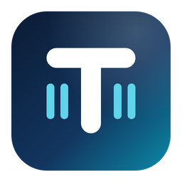
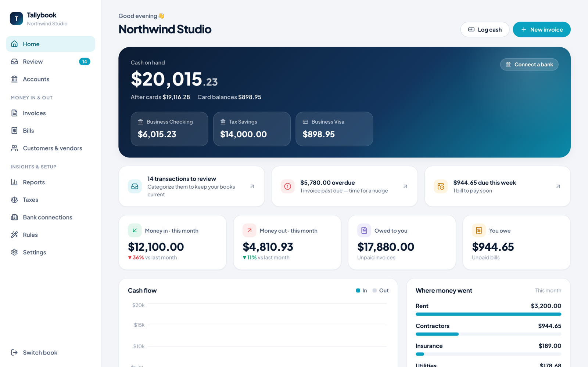
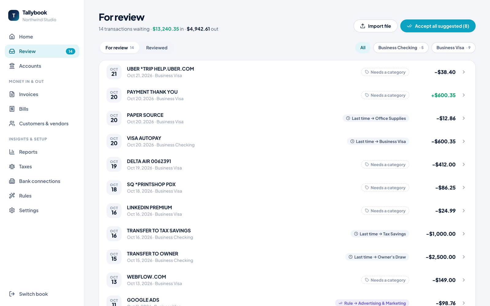
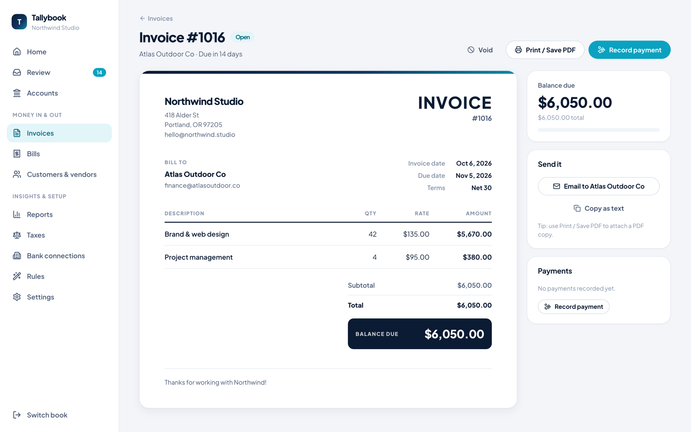
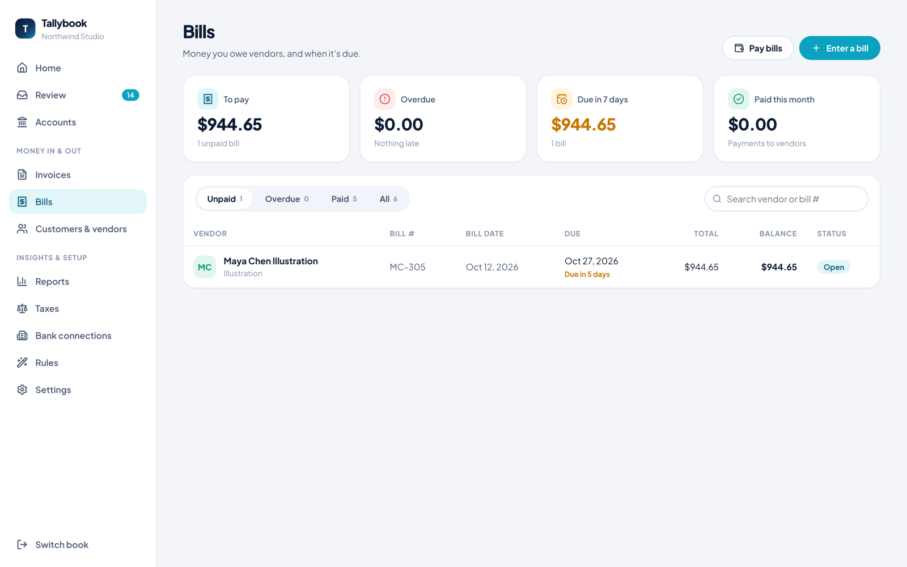
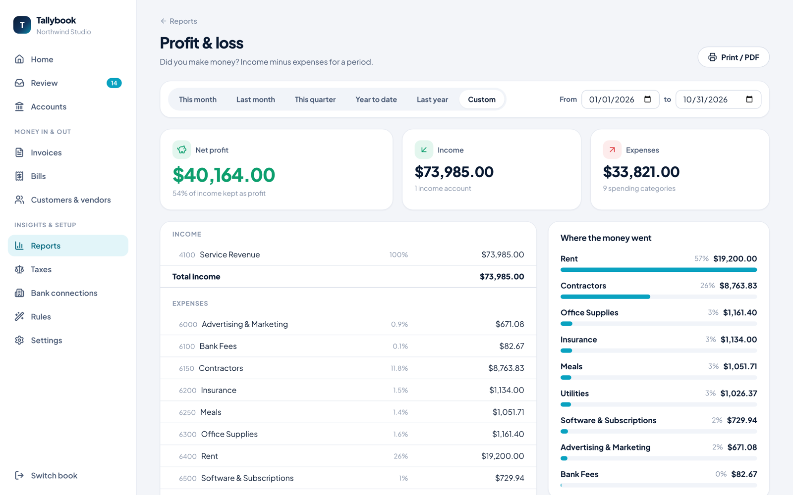
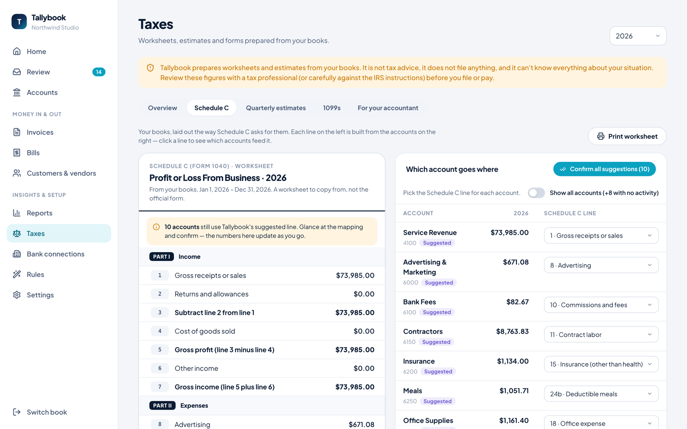
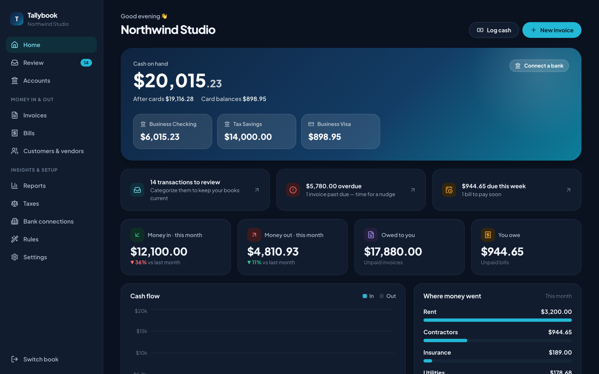

# Tallybook

**Bookkeeping for small businesses, and a budget for the home, on your own computer.**

Bank feeds, invoices, bills, reports and tax prep for the business. Budgets,
bills and savings goals for the household. All of it in one file that you
own. Free for your household; add your business for $19.99, once, and tax
prep for $49.99 a tax season.

[**Download**](https://tallybook-app.netlify.app/download/) · [Pricing](https://tallybook-app.netlify.app/pricing/) · [See it in action](#a-quick-tour) · [Household budget](#your-household-budget) · [Questions](#questions)

 

---

## Why Tallybook?

**Your books stay with you.** Everything lives in a single file on your
computer: no account to create, no monthly fee, nothing uploaded to anyone's
cloud. Copy it, back it up, or hand it to your accountant.

**It does the boring part for you.** Connect your bank and transactions flow
in. Tallybook suggests where each one goes, learns from your choices, and
spots payments you've already recorded so nothing gets counted twice.

**Real bookkeeping, plain English.** Underneath it's proper double-entry
accounting your accountant will recognize. On screen it says "Money in,"
"Owed to you," and "Where did this go?"

**Tax time without the dread.** A Schedule C worksheet built from your books,
a quarterly estimated-tax plan, and 1099 tracking for your contractors.

**The business and the home, kept apart.** Run a household budget on its
own, or next to your business in the same book. Taxes only ever see the
business side, and when business money pays for something at home,
Tallybook records it as an owner's draw.

---

## A quick tour

### Home: your money at a glance
Cash on hand, card balances, what's coming in and going out, and a short list
of things that need you.

### Review: categorize in seconds
New bank transactions land here with a suggestion: a match to something you
already entered, a rule you set up, or what you picked last time. Accept one
at a time or all at once. Every action can be undone.

Cash from the till, a check, anything the bank will never see? **Log cash**
records it in a few taps, and cash paid to a contractor still counts toward
their 1099.

### Invoices: get paid
Create a clean, professional invoice, print it or save it as a PDF, and record
payments as they arrive. When the deposit shows up in your bank feed,
Tallybook matches it automatically.

### Bills: stay on top of what you owe
Enter bills as they come in, see what's due this week, and pay from checking
or a credit card.

### Reports: the numbers that matter
Profit & loss, balance sheet, and who owes you (and who you owe), for any
date range, ready to print.

### Taxes: prepared, not guessed
For sole proprietors and single-member LLCs:

- **Schedule C worksheet.** Each of your categories is mapped to the right
  line, with meals limited to 50% and the home-office deduction.
- **Quarterly estimates.** How much to pay and when, using the IRS "safe
  harbor" rule so you avoid underpayment penalties.
- **1099s.** Who you paid enough to need one, with card payments correctly
  left out.
- **Accountant package.** Everything your preparer needs, in one folder.

> Tallybook prepares worksheets and estimates; it isn't tax advice and never
> files anything for you. Have a tax professional review before you file.
> [What it does and doesn't cover →](https://tallybook-app.netlify.app/help/taxes/)

### Light or dark
Follows your system, or pick one in Settings.

---

## Your household budget

For the money at home: a household-only book, or a household side on your
business book. Each side keeps its own accounts, categories and numbers.

### Month: the plan against what's real
Plan each month by category (groceries, rent, kids), by person (who the money
was for), or both. Every line has a meter that knows how far into the month
you are, so rent paid on the 1st isn't overspending and a slow start isn't a
false alarm.

- **Spend up to, or get at least.** Most lines are a ceiling. Some, like
  savings or income, are a floor you want to reach.
- **The plan carries forward.** Set it once and next month starts from it.
- **Alerts that matter.** A heads-up when a line runs hot or goes over,
  when a goal line falls behind, or when a bill is due or looks unpaid. Not
  a wall of red.

### Bills and due dates
What's due today, this week and later, with weekly, monthly, quarterly and
yearly bills. A bill ticks itself off when the payment shows up from your
bank, and bills that change month to month (power, water) still match.

**Tallybook spots them for you.** Import a few months of bank history and it
finds the payments that repeat, like rent, insurance, subscriptions and a
weekly allowance, and offers each as a bill in one click. Not a bill? Wave it
off and it won't ask again.

### Goals: saving toward something
A new car, an emergency fund, a trip. Money for a goal sits in a real
account, so the progress is real too. Goals build up month after month, and
Tallybook tells you when you'll get there at the rate you're going, or what
it takes each month to hit your date.

### Where there's room
Spending sorted into fixed (rent, loan), moves-with-use (gas, power) and
your-choice (eating out), so you can see what can actually change. Plus a
budget score to watch (300 to 850, and no, it isn't a credit score) and
credit for the wins: coming in under, or putting money aside.

### Cash and everything else
**Log money** records cash spending, money in, or money moved between your
accounts, and who it was for.

### Moving from Ledger
Already budgeting in the Ledger app? **Settings → Move from Ledger**
brings over your people, categories, monthly plans, history, bills and
goals, and turns your saved stores into rules. Run it again later and it
adds only what's new.

---

## Getting started

1. **Download** the installer for your computer from the
   [download page](https://tallybook-app.netlify.app/download/).
2. **Open Tallybook** and create a book for your business, your household,
   or both.
3. **Bring in your transactions**, any of these ways:
   - **Connect your bank** through SimpleFIN. See the
     [bank connection guide](https://tallybook.app/help/bank-connections/).
   - **Import a statement**: download a CSV or OFX/QFX file from your bank's
     website and drop it into Review.
   - **Log cash** by hand for anything the bank won't see.
4. **Review** your transactions, and you're bookkeeping. For a household,
   set this month's plan in **Month** and add the bills Tallybook spotted.

<b>"Tallybook can't be opened" on Mac, or "Windows protected your PC"</b>

 

Early versions of Tallybook aren't signed by Apple or Microsoft yet, so your
computer asks before opening it the first time.

- **Mac:** right-click Tallybook in Applications, choose **Open**, then
  **Open** again. If it says the app is damaged, run
  `xattr -cr /Applications/Tallybook.app` in Terminal and try again.
- **Windows:** click **More info**, then **Run anyway**.

You only need to do this once.

---

## Use it with AI agents

Tallybook can run without its window as an MCP server, so an AI agent (Claude,
OpenAI's Codex and Agents SDK, OpenClaw, or anything else that speaks MCP) can
answer questions about your books and, if you allow it, keep them: categorize
the review inbox, record cash, plan the month. Read-only unless you say
otherwise. [Set it up →](docs/AGENTS.md)

---

## Your data, your rules

- **One file.** Your books are a single `.tallybook` file, in
  `Documents/Tallybook` unless you choose somewhere else.
- **Backups.** **Settings → Back up now** saves a complete copy next to your
  book. Copying the file works too.
- **Encryption.** One click locks the whole book file with a random 256-bit
  key. It opens normally on your computer (the key lives in your keychain),
  and you keep a **recovery key** for anywhere else. Without the key, the
  file is unreadable.
- **Encrypted cloud copies.** Send encrypted copies to Google Drive, iCloud
  Drive, Dropbox, OneDrive or Nextcloud (any synced folder), or push them to a
  Git repository. Only encrypted books can leave your computer.
- **Bank logins stay secret.** Bank access is stored in your computer's
  keychain, never in the book file. Your bank password is only ever typed
  into your bank's own page.
- **Nothing is quietly changed.** Mistakes are fixed by voiding, which keeps
  a record, rather than by deleting history. Lock past periods once you've
  filed taxes.
- **No tracking.** Tallybook doesn't phone home.

---

## Questions

**Is it really free?**
The household budget is, for good: budgets, bills, goals, bank import,
reports and encryption. Keeping a business is a one-time $19.99, yours for
good. Business plus tax prep is $49.99 a tax season (it covers the year you buy
it in and the one before), and returning customers renew for $29.99. Nothing
renews by itself, and there's no account. Bank
connections use your own SimpleFIN account, which costs about $15/year, and
file import is always free.

**Can I use it just for my household?**
Yes. Pick **A household** when you create a book and you get budgets, bills and
goals without any of the business screens. You can add a business side later in **Settings → Business & household**.

**Can I move from QuickBooks?**
Start fresh with your current balances: add your accounts with an opening
balance, then import recent bank statements. A direct QuickBooks import is on
the wishlist.

**Does it work for my accountant?**
Yes. It's standard double-entry bookkeeping, and **Taxes → For your
accountant** exports your Schedule C worksheet, general ledger and more as
readable PDFs and spreadsheets.

**Does it do payroll or file my taxes?**
No. Tallybook keeps your books and prepares your tax numbers. It doesn't run
payroll or submit anything to the IRS.

**Mac, Windows, Linux?**
There are installers for all three. Mac is the most tested so far, so
please [report anything odd](https://github.com/jasonsutter87/tallybook/issues)
on Windows or Linux.

---

## License

Tallybook's source is public under the [Functional Source License](LICENSE)
(FSL-1.1-ALv2): read it, build it, change it and use it for yourself, but
don't sell it or build a competing product with it. Each release becomes
Apache-2.0 two years after it's published. Versions 0.2.0 and earlier were
released under the AGPL-3.0 and remain available under it.

Want to dig in? See the [developer guide](docs/DEVELOPMENT.md).

---

Built with care for freelancers, small businesses, and the households behind them.
[tallybook-app.netlify.app](https://tallybook-app.netlify.app)

